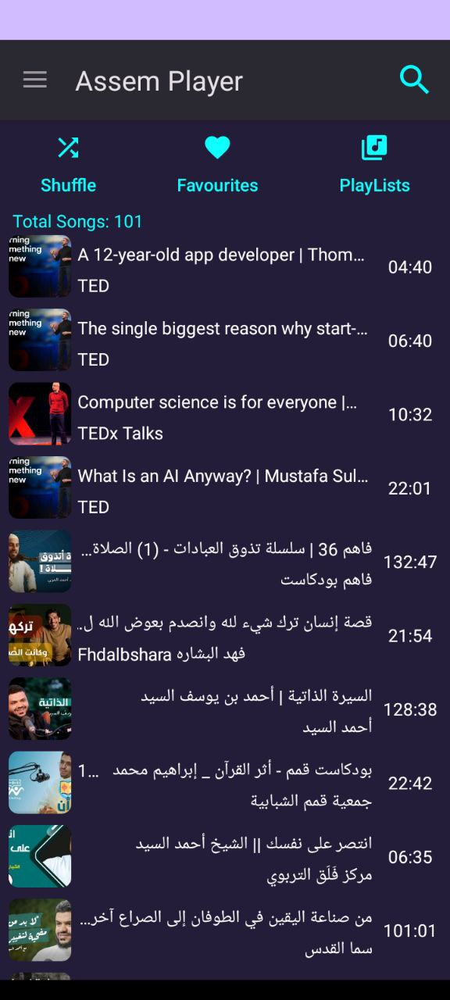
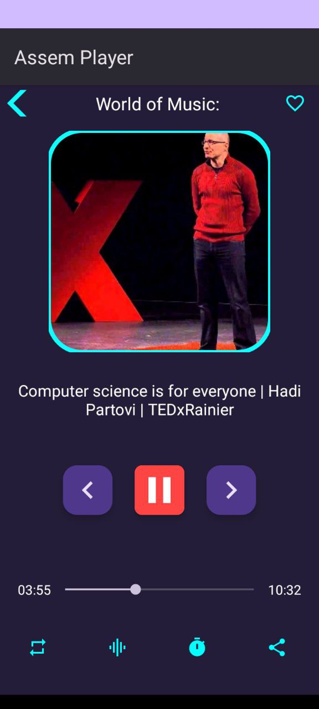

<div align="center">


# Assemplayer

A local music player for Android, built with Kotlin.

</div>

<p align="center">
  
  &nbsp;&nbsp;
  
</p>

## Features

- Scans and plays every audio file on the device via `MediaStore`
- Background playback through a foreground service, with a media-style notification (play/pause/next/previous/exit) and lock screen controls
- Playlists, favourites, and shuffle
- In-app search
- Sleep timer (15 / 30 / 60 minutes)
- System equalizer launcher
- Share a track to another app
- Light/dark theme (follows system)
- In-app feedback form, emailed directly from the app

## Built with

- Kotlin, View Binding
- `MediaPlayer` + `MediaSessionCompat` + a foreground `Service` for playback
- [Glide](https://github.com/bumptech/glide) for album art
- [Gson](https://github.com/google/gson) for persisting favourites/playlists to `SharedPreferences`
- Gradle 8.9, Android Gradle Plugin 8.0.2, Kotlin 1.8.20

**Requirements:** `minSdk 24` (Android 7.0) &middot; `targetSdk` / `compileSdk 34`. Tested through Android 16.

## Getting started

1. Clone the repo and open it in Android Studio.
2. Copy `local.properties.example` to `local.properties` and fill in `sdk.dir`.
3. (Optional) To enable the in-app feedback form, also fill in `feedback.email` and `feedback.app.password` in `local.properties` with a [Gmail App Password](https://myaccount.google.com/apppasswords) — **never your real account password**. Leave them blank to ship without this feature; the button will show a toast instead of crashing.
4. Build and run:
   ```
   ./gradlew assembleDebug
   ```

`local.properties` is gitignored and never committed — see [Security notes](#security-notes) below.

## Permissions

| Permission | Why |
|---|---|
| `READ_MEDIA_AUDIO` (Android 13+) / `READ_EXTERNAL_STORAGE` (below 13) | List and play audio files from device storage |
| `FOREGROUND_SERVICE`, `FOREGROUND_SERVICE_MEDIA_PLAYBACK` | Keep music playing with a notification when the app is in the background |
| `INTERNET`, `ACCESS_NETWORK_STATE` | Send feedback email over SMTP, and check connectivity first |

## Security notes

The feedback form sends mail directly from the device over Gmail SMTP using an App Password. Credentials are **never hardcoded** — they're injected at build time from your local, gitignored `local.properties` into `BuildConfig`. If you fork this project, generate your own App Password; don't reuse anyone else's.

## License

[MIT](LICENSE)
